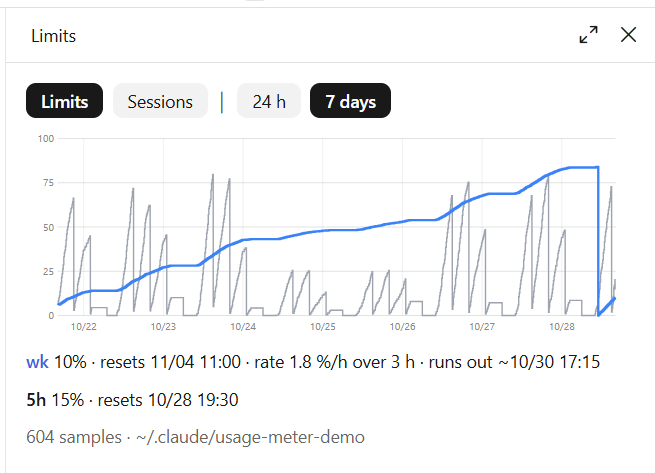
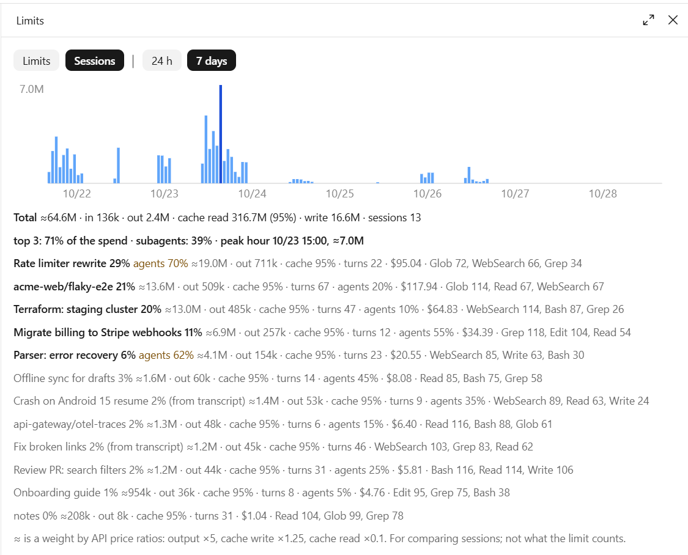

# usage-meter

A Claude Code mod that keeps a history of your plan limits and of what each
session spends, and charts both in a pane. It costs no tokens: it records the
figures the engine already reports after every model response and every turn,
and makes no requests of its own.



- **Limits.** The 5-hour and weekly windows (and any other window the plan
  reports), written only when a window moves a whole point. The status line
  shows the current percentages.
- **Sessions.** Per session: input, output, cache read and cache write tokens,
  per hour and per model, the main loop and subagents apart, tool call counts,
  and the session's cost.
- **Pane.** `/usage-meter` opens it. *Limits*: the chart over 24 hours or 7
  days, the current value, the burn rate over the last 3 hours and a forecast
  for the reset. *Sessions*: tokens per hour and the heaviest sessions.



The screenshots show made-up data.

## Install

At the prompt of a terminal session:

```
/plugin install usage-meter --marketplace deadmanswitchvultures/usage-meter
```

Answer `y` to *Add marketplace?*, then press Enter to install at the user
scope, so the mod loads in every session on the machine.

From a shell:

```
claude plugin install usage-meter --marketplace deadmanswitchvultures/usage-meter
```

In the desktop app, where `/plugin` does not run: click + next to the prompt
box, then Plugins, Add marketplace with `deadmanswitchvultures/usage-meter`,
then Add plugin.

The mod starts recording from the next model response. Run `/usage-meter` to
open the pane.

## Language

English, Russian, Chinese (Simplified), Spanish, Portuguese, Japanese, German,
French and Korean. The `language` option (`/config`, or
`pluginConfigs["usage-meter@flint-mods"].options.language` in settings.json)
takes `auto` or a code: `en`, `ru`, `zh`, `es`, `pt`, `ja`, `de`, `fr`, `ko`.
With `auto`, the default, the mod follows Claude Code's own `language` setting
(the language Claude answers in), then the system locale (`LC_ALL`, `LANG`),
then English. It is read when a session starts.

Adding a language is one table in `hooks/i18n.ts`; pull requests are welcome.

## Data

Everything stays on your machine, under `~/.claude/usage-meter/`:

- `limits/<yyyy-mm>/<session>.jsonl`: one line per change of the limits;
- `sessions/<session>.json`: one small file per session.

Each session writes only its own files, so parallel sessions never collide.
The pane reads a file again only when its size or time changed, and skips
files older than the range it shows.

The environment variable `USAGE_METER_DIR` moves the folder elsewhere; set it
in the `env` block of `~/.claude/settings.json` to reach sessions the desktop
app starts. `tools/backfill.py --out <folder>/sessions` writes there too.

Nothing is deleted on its own. A session's files take a few kilobytes; to
start over, delete the folder.

## Backfill

Limits cannot be recovered for the past, but session spend can, from the
transcripts in `~/.claude/projects` (and WSL's, on Windows). It needs Python
3.9 or later:

```
python3 tools/backfill.py            # last 7 days
python3 tools/backfill.py --days 30
```

On Windows use `py` in place of `python3` (a bare `python` there may open the
Microsoft Store). The script is in the plugin's folder; `claude plugin list`
shows where that is.

It streams each transcript and parses only the lines it needs; a week of
transcripts (about 0.5 GB) takes a few seconds. Sessions the mod already
records are left alone.

## Notes

- The weight shown next to sessions (≈) ranks them by API price ratios
  (output ×5, cache write ×1.25, cache read ×0.1). It is not what the plan
  limit counts.
- Whether a per-model weekly window appears depends on what the plan reports.

## Developing

```
git clone https://github.com/deadmanswitchvultures/usage-meter
claude --plugin-dir ./usage-meter
```

A session started this way reloads the mod each time a file is saved. On its
first load the engine writes the API's types into `.claude-plugin/types/`,
which `tsconfig.json` extends, so the editor and `tsc -p .` work from then on.

```
claude plugin test .       # the tests in hooks/*.test.tsx
claude plugin validate .   # what the engine would load or refuse
```

Installed from a local folder (`claude plugin marketplace add <folder>`), the
mod is read from that folder: after an edit, `/reload-plugins` in any open
session picks it up.

## License

MIT
